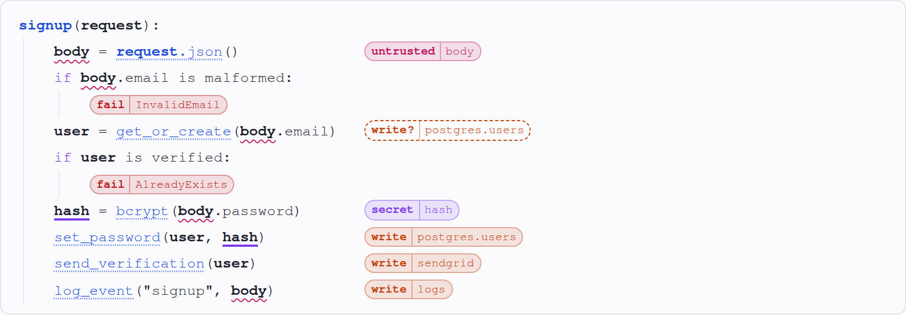
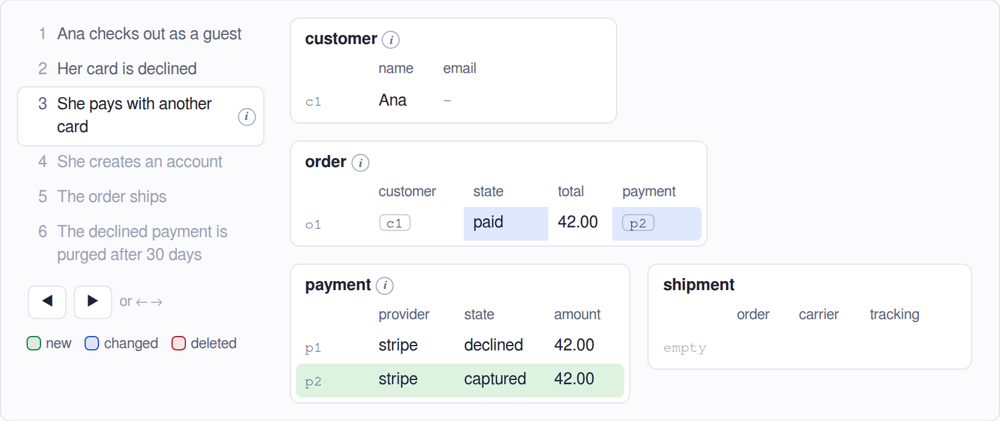

# Skeudo

> Experimental, 0.x: the format can still change in any minor version. [CHANGELOG.md](CHANGELOG.md) lists the changes.

Small text formats for explaining code to a reader. Each format is a **view**:

- **code**: readable pseudocode for code review, loose about logic and strict about effects. Every read, write and failure is tagged, so a reviewer sees what the code touches before reading how.
- **data**: a data model as a few tables with example rows, and a story of how the rows change.

A sketch lives in a ` ```skeudo ` fence in any Markdown file, or in a `.skeudo` file. You can write one by hand, or ask an agent to sketch a function, a commit or a pull request.

```
signup(request):
    body = request.json()                 ::untrusted:body
    if body.email is malformed:
        ::fail:InvalidEmail
    user = get_or_create(body.email)      ::write?:postgres.users
    if user is verified:
        ::fail:AlreadyExists
    hash = bcrypt(body.password)          ::secret:hash
    set_password(user, hash)              ::write:postgres.users
    send_verification(user)               ::write:sendgrid
    log_event("signup", body)             ::write:logs
```

Rendered, the tags line up in a column, and hovering a name highlights its other uses:



A data sketch starts with a `data` line, declares its tables, then tells a story. Each step adds, changes or removes rows, and the reader steps through it:

```
data
table customer(name, email)
table order(customer -> customer, state, total, payment -> payment)
table payment(provider, state, amount)

Ana checks out as a guest
  + customer c1  name: Ana | email: null
  + order o1     customer: c1 | state: pending | total: 42.00

Her card is declined
  + payment p1   provider: stripe | state: declined | amount: 42.00
  ~ order o1     payment: p1
```



## Get it

| To | Use |
| --- | --- |
| Try it in a browser | [The playground](https://skeudo.dev/playground/) on [skeudo.dev](https://skeudo.dev), with both views and a few examples. |
| Have an agent write sketches | The agent skill: `npx skills add wlezzar/skeudo`. It works with Claude Code and the other agents the [skills CLI](https://github.com/vercel-labs/skills) supports. Then ask it to "sketch this pull request". |
| Read sketches in VS Code | [The extension](https://marketplace.visualstudio.com/items?itemName=wlezzar.skeudo-vscode) highlights sketches and renders them in the Markdown preview: `code --install-extension wlezzar.skeudo-vscode`. See [apps/vscode](apps/vscode/README.md). |
| Check sketches and send them as pages | The CLI: `npm install -g skeudo`, then `skeudo check` and `skeudo render`. See [apps/cli](apps/cli/README.md). |
| Show sketches on a docs site | [`markdown-it-skeudo`](packages/markdown-it/README.md) for VitePress and other markdown-it sites, [`remark-skeudo`](packages/remark/README.md) for Docusaurus, Astro and MDX. |
| Build your own tools | [`@skeudo/core`](packages/core/README.md), the parser, and [`@skeudo/html`](packages/html/README.md), the renderer. |

## The format

[spec/spec.md](spec/spec.md) is what every view shares, and each view has its own spec: [code](spec/code.md) and [data](spec/data.md).

## Development

Skeudo has views, like Mermaid's diagram types: each is a kind of sketch with its own grammar and rendering, and a sketch names its view on its first line. Each view's code lives in a folder named after it inside `spec/`, `packages/core/src`, `packages/html/src` and `apps/vscode/src/grammars`. The rest goes through the registry in `packages/core/src/views.ts` and never names a view.

```
spec/
  spec.md        # what every view shares: fences, files, the line that names the view, warnings
  code.md        # the code view: syntax, variables and labels, rendering
  data.md        # the data view: tables, steps and changes, rendering
  fixtures/      # per view: .skeudo inputs and the .json the parser must produce
skills/
  skeudo/        # agent skill that writes sketches of code, commits and PRs
packages/
  core/          # @skeudo/core: parse() and the view registry; per view: parser, analysis, AST types
  html/          # @skeudo/html: toHtml(), toHast(), enhance() + skeudo.css; per view: renderer, interaction, styles
  markdown-it/   # markdown-it-skeudo: renders ```skeudo fences and inline tag code
  remark/        # remark-skeudo: the same for remark and MDX, as a hast tree
apps/
  cli/           # skeudo: checks sketches and renders them as standalone HTML pages
  playground/    # the skeudo.dev site: a landing page, and the live editor (preview, review panel, AST)
  vscode/        # VS Code extension: highlights sketches and renders them in the Markdown preview
scripts/         # build helpers the packages and apps share
```

In the repository, packages export their TypeScript sources, so tests, the playground and the bundled apps need no build. `pnpm build:packages` compiles the four libraries to `dist/`, and publishing uses that.

```sh
pnpm install
pnpm dev             # the site, at http://localhost:5173, with the playground at /playground/
pnpm test            # every package; see spec/fixtures/README.md for the parser fixtures
pnpm typecheck
pnpm build           # the static site in apps/playground/dist
pnpm build:packages  # the libraries, in packages/*/dist
pnpm build:cli       # CLI in apps/cli/dist/skeudo.js, see apps/cli/README.md
pnpm package:cli     # CLI as apps/cli/skeudo.tgz, for npm install -g
pnpm package:vscode  # VS Code extension in apps/vscode/skeudo-vscode-<version>.vsix, see apps/vscode/README.md
```

Markdown files in `apps/playground/local-examples/` (gitignored) appear in the playground's Example menu, so you can try sketches of private code. Optional front matter sets the menu title and the base URL for source links in sketches without `::repo`:

```markdown
---
title: my-service a1b2c3d
srcBase: https://github.com/org/my-service/blob/a1b2c3d/
---
```

## License

[MIT](LICENSE)
